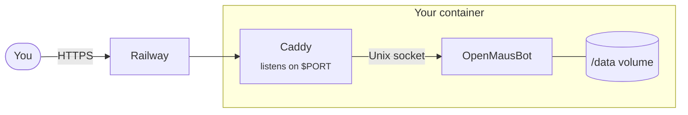

<div align="center">

<h1>OpenMausBot on Railway</h1>

<p>
  Host your own <a href="https://github.com/milind-soni/OpenMausBot">OpenMausBot</a> on <a href="https://railway.com">Railway</a>.<br/>
  It runs the official image, so there's no code to build or maintain.
</p>

<p>
  <a href="https://github.com/KiraQiez/openmausbot-railway/actions/workflows/ci.yml"></a>
  <a href="LICENSE"></a>
  <a href="https://railway.com"></a>
</p>

<p>
  <a href="SETUP.md"><b>Setup Guide</b></a> ·
  <a href="#how-it-works">How It Works</a> ·
  <a href="#configuration">Configuration</a> ·
  <a href="SETUP.md#troubleshooting">Troubleshooting</a>
</p>

</div>

<br/>

## What is this?

OpenMausBot is a self-hosted AI coding assistant. It's built to run on your own machine, so out of the box it **only accepts connections from inside its own computer**.

This repo adds a small layer that lets it run safely on Railway. You get:

|  |  |
|---|---|
| **Always up to date** | Every redeploy pulls the latest official OpenMausBot release. |
| **No passwords** | You sign in each device once with a one-time pairing link. |
| **Ready to code** | Claude Code and Codex come preinstalled. |
| **Nothing gets lost** | Chats, sign-ins and devices are saved on a Railway volume. |

<br/>

## Quick start

### One click

[](https://railway.com/deploy/openmausbot-1)

The template sets up the service, the `/data` volume, the domain and the variables for you. When it's **Active**, jump to [signing in](SETUP.md#step-6--sign-in).

### By hand

> **New to Railway?** Follow the **[Setup Guide](SETUP.md)**. It walks through every click in about 10 minutes.

If you've used Railway before:

1. Fork this repo, then in Railway choose **New Project → Deploy from GitHub repo**.
2. Attach a volume mounted at **`/data`**.
3. Generate a domain on port **`8080`**.
4. Add these variables:
   ```env
   PORT=8080
   OMB_PUBLIC_URL=https://<your-domain>
   OMB_WEBHOOK_PUBLIC_URL=https://<your-domain>
   ```
5. Pair your browser:
   ```sh
   railway ssh -- openmausbot pair --ttl 24h
   ```

<br/>

## How it works



**The problem:** OpenMausBot only talks to programs on the same machine. Railway's network sits outside the container, so it can't reach the server.

**The fix:** [Caddy](https://caddyserver.com), a small web server, runs in the same container. It takes visitors from Railway and passes them to OpenMausBot through a private **Unix socket**, a connection that exists only inside the container.

**Staying secure:** the server treats every visitor who comes in through Caddy as a stranger, so each device has to be paired before it can do anything.

<br/>

## What's inside

| File | Purpose |
|---|---|
| [`Dockerfile`](Dockerfile) | Starts from the official image, then adds Caddy and the engine CLIs. |
| [`railway/Caddyfile`](railway/Caddyfile) | Tells Caddy to forward web traffic to OpenMausBot. |
| [`railway/start.sh`](railway/start.sh) | Runs when the container starts. Prepares the volume, then starts OpenMausBot and Caddy. |
| [`railway/openmausbot.sh`](railway/openmausbot.sh) | The `openmausbot` command you run through `railway ssh`. |
| [`railway/TEMPLATE.md`](railway/TEMPLATE.md) | The overview shown on the Railway template page. |
| [`.github/workflows/ci.yml`](.github/workflows/ci.yml) | Checks the scripts and test-builds the image on every push. |

<br/>

## Configuration

Set these in your Railway service's **Variables** tab.

| Variable | Required | Description |
|---|:---:|---|
| `PORT` | ✓ | The port Caddy listens on. Use `8080`, the same port you give the domain. |
| `OMB_PUBLIC_URL` | ✓ | Your app's public address, e.g. `https://my-bot.up.railway.app`. |
| `OMB_WEBHOOK_PUBLIC_URL` | ✓ | Where webhooks are sent. Use the same value as above. |
| `ENGINES` |  | Which AI coding tools to install. Defaults to Claude Code and Codex. Leave it empty to install none. |

**Memory:** plan for about **1 GB** while idle, plus about **700 MB** for each bot that's working.

<br/>

## Updating

| To get… | Do this |
|---|---|
| The newest OpenMausBot | Click **Redeploy** in Railway. |
| The newest version of this repo | Click **Sync fork** on GitHub. Railway redeploys on its own. |

<br/>

## License

[MIT](LICENSE). OpenMausBot itself is a separate project with [its own license](https://github.com/milind-soni/OpenMausBot).
